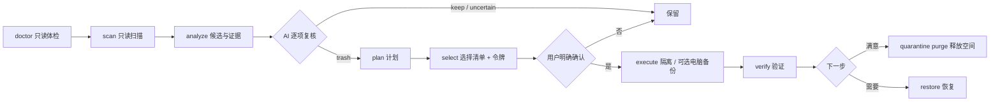

<h1 align="center">Android / HarmonyOS Deep Clean</h1>

<p align="center">
  <b>简体中文</b> | <a href="./README_EN.md">English</a>
  <br><br>
  <a href="https://github.com/ChenChen913/android-deep-clean/actions/workflows/ci.yml"></a>
  <a href="LICENSE"></a>
  
</p>

面向 Android 与 HarmonyOS 的 AI 深度清理 Skill：只读扫描、证据复核、隔离清理与恢复。

> 当前状态：电脑端 USB + ADB 与手机端 local 通路的只读链路已在真机验证；隔离、验证、恢复已用自建测试文件在真机演练通过。**尚未对用户真实数据完成清理验收，HarmonyOS NEXT 真机验收数为 0。** 未达到正式清理工具门槛，进度见 [真机验收清单](docs/real-device-test-plan.md)。

真实终端节选（HONOR HLK-AL00，HarmonyOS 3.0 兼容版 / Android 10，USB + ADB，序列号已隐去）：

```text
$ python "$Skill/scripts/adc.py" devices --adb-path adb
<serial>  device  product:HLK-AL00 model:HLK_AL00

$ python "$Skill/scripts/adc.py" scan --state .adc-state --transport adb --serial <serial> --json --quiet
{"roots_scanned": ["/sdcard"], "stats": {"entries": 125855, "files": 117007, "bytes": 25093192713}, "truncated": false}

$ python "$Skill/scripts/adc.py" analyze --state .adc-state --transport adb --serial <serial> --json --quiet
{"summary": {"candidate_groups": 59, "candidate_files": 74885,
             "candidate_bytes": 5390767059, "review_required": 56}}
```

清理流程的强制顺序：



## 目录

- [为什么做这个项目](#为什么做这个项目)
- [快速开始](#快速开始)
- [用法](#用法)
- [配置](#配置)
- [项目结构](#项目结构)
- [开发](#开发)
- [常见问题](#常见问题)
- [已知限制](#已知限制)
- [如何贡献](#如何贡献)
- [许可证](#许可证)

## 为什么做这个项目

普通清理工具通常按目录名、文件年龄或体积判断，容易把聊天图片、卸载残留里的游戏存档、离线安装包一起扫掉，也不会解释“为什么建议删”。

这个项目把清理拆成可审计的步骤：

- 扫描只读，报告写明每个候选的路径、数量、大小、年龄、应用是否仍安装；
- AI 必须逐项复核并写出理由，未复核的 CAUTION 不能进入选择清单；
- 用户选择后生成确认令牌，没有令牌不能执行；
- 默认把文件移动到设备隔离区，可恢复；永久删除是单独、显式的第二步；
- 执行前重新校验大小、mtime、inode，文件有变化就跳过并报告。

核心目标不是“删得快”，而是发现长期积累、隐藏较深、普通工具忽略的文件，同时不误删重要数据。

## 快速开始

前置要求：

| 项目 | 要求 |
|---|---|
| Python | 3.9+（产品代码只用标准库，不需要 pip 安装依赖） |
| 电脑端（Android / HarmonyOS 兼容版） | Windows 10/11 或 macOS/Linux，Android 官方 Platform Tools（含 `adb`，不需要 Android Studio） |
| 电脑端（HarmonyOS NEXT） | 含 `hdc` 的 HarmonyOS Command Line Tools 或 SDK toolchains（不需要 DevEco Studio 全套 IDE） |
| 手机端（可选） | Android 手机 + Termux，或 Shizuku + rish |
| 测试（可选） | pytest |

安装到 Agent Skills 目录（Windows）：

```powershell
git clone https://github.com/ChenChen913/android-deep-clean.git
cd android-deep-clean
powershell -ExecutionPolicy Bypass -File .\android-deep-clean\scripts\install_skill.ps1
python "$env:USERPROFILE\.agents\skills\android-deep-clean\scripts\adc.py" --version
```

最后一条命令应输出 `android-deep-clean 1.4.0`。安装脚本会先备份旧目录，复制后校验 `SKILL.md`、`scripts/adc.py`、`platform.py`，失败自动回滚。

macOS / Linux 安装到通用 skills 目录：

```bash
git clone https://github.com/ChenChen913/android-deep-clean.git
mkdir -p ~/.agents/skills
cp -R android-deep-clean ~/.agents/skills/android-deep-clean
python ~/.agents/skills/android-deep-clean/scripts/adc.py --version
```

也可以不安装，直接从仓库运行 `python android-deep-clean/scripts/adc.py --help`。

卸载（Windows）：

```powershell
Remove-Item -Recurse -Force "$env:USERPROFILE\.agents\skills\android-deep-clean"
Remove-Item -Recurse -Force .adc-state
```

删除状态目录会同时失去隔离区的恢复 journal。确认隔离区没有需要恢复的文件后再删。

## 用法

先选通路。三条通路共用同一套分类、风险等级、保护清单、确认令牌、执行器和验证器，区别只在 Transport 层。

| 通路 | 适用设备 | 连接方式 | 关键参数 |
|---|---|---|---|
| A 电脑端 ADB | Android、HarmonyOS 1.x–4.x 兼容版 | USB 数据线 + USB 调试 | `--transport adb --serial <序列号>` |
| B 手机端 | Android、HarmonyOS 1.x–4.x 兼容版 | Termux 本机 shell 或 Shizuku rish | `--transport local` 或 `--transport rish` |
| C 电脑端 HDC | HarmonyOS NEXT（5+） | USB / 无线调试 + `hdc` | `--transport hdc --serial <connect-key> --hdc-path hdc` |

HarmonyOS NEXT 不能运行本项目的手机端通路：它没有 Android 运行时，也没有 Termux、Shizuku、adb。

### 电脑端：USB + ADB 完整流程

所有通用参数必须写在子命令之后，例如 `doctor --state ...`，不能写成 `--state ... doctor`。多设备时必须用 `--serial` 指定目标。

**第 1 步：准备手机**

1. 设置 → 关于手机，连续点击版本号 7 次，开启开发者选项。
2. 开发者选项 → 打开 USB 调试。
3. 用数据线连接电脑，USB 模式选“传输文件”或“仅充电”均可。
4. 解锁手机，在“允许 USB 调试吗”弹窗中勾选始终允许并确认。

**第 2 步：准备电脑**

安装 Android 官方 Platform Tools，确认 `adb version` 能运行。不需要安装 Android Studio。

**第 3 步：确认设备**

```powershell
$Skill = "$env:USERPROFILE\.agents\skills\android-deep-clean"
$State = ".adc-state"
$Serial = "<序列号>"

python "$Skill\scripts\adc.py" devices --adb-path adb
```

状态说明：

| 状态 | 含义与处理 |
|---|---|
| `device` | 已授权，可以继续 |
| `unauthorized` | 手机上没点允许；重新插拔并解锁手机 |
| `offline` | 重新插拔，或在手机上关闭再打开 USB 调试 |
| `no permissions` | 检查数据线、USB 模式与驱动 |

如果 `adb` 不在 PATH，用实际路径替换：`--adb-path "$env:LOCALAPPDATA\Android\platform-tools\adb.exe"`。

**第 4 步：只读体检**

```powershell
python "$Skill\scripts\adc.py" doctor --state $State --transport adb --serial $Serial
```

读报告里的设备型号、系统版本、总容量与可用空间、权限级别，以及哪些路径不可读。权限级别为 `blocked` 时停止，不要继续扫描。

**第 5 步：只读扫描**

```powershell
python "$Skill\scripts\adc.py" scan --state $State --transport adb --serial $Serial
```

默认扫描 `/sdcard`；Root 下会追加 `/data/data/*/cache`。常用参数：`--roots /sdcard/Download`、`--max-depth 32`、`--max-files 500000`、`--no-internal`、`--no-media`。扫描结果写入 SQLite 快照，不改手机文件。

v1.4.0 起，`scan` 还会尝试只读查询 Android MediaStore，把媒体索引写入 `scan/aux/`，仅用于交叉验证；`--no-media` 可关闭该采集。

**第 6 步：分析并生成证据**

```powershell
# 设备端计算重复文件哈希（默认）
python "$Skill\scripts\adc.py" analyze --state $State --transport adb --serial $Serial

# 或：只把大小相同的重复候选拉到电脑，本地计算 SHA-256
python "$Skill\scripts\adc.py" analyze --state $State --transport adb --serial $Serial --hash-mode pc
```

产出：

| 文件 | 用途 |
|---|---|
| `report-before.md` | 人类可读的清理前报告 |
| `analysis-summary.json` | AI 优先读的摘要 |
| `analysis.db` | 完整候选与逐文件清单 |
| `review-template.json` | 复核模板 |

**第 7 步：AI 复核**

AI 读 `analysis-summary.json`，对体积大、风险高、证据弱的候选运行：

```powershell
python "$Skill\scripts\adc.py" inspect --state $State --transport adb --serial $Serial --id <候选ID> --list-paths
```

把结论写成 `review.json`，格式见 [SKILL.md](android-deep-clean/SKILL.md) 与 [复核指南](android-deep-clean/references/review-guide.md)。未复核的 CAUTION 不能进入选择清单。

**第 8 步：生成计划**

```powershell
python "$Skill\scripts\adc.py" plan --state $State --transport adb --serial $Serial --review "$State\analysis\review.json"
```

plan 只生成计划，不执行。把可选范围、风险、保留建议展示给用户。

**第 9 步：用户选择并生成令牌**

```powershell
# 按分类选择（示例）
python "$Skill\scripts\adc.py" select --state $State --transport adb --serial $Serial --categories app_cache,thumbnails

# 只选所有可选 SAFE 项
python "$Skill\scripts\adc.py" select --state $State --transport adb --serial $Serial --all-safe

# 精确 ID（最安全）
python "$Skill\scripts\adc.py" select --state $State --transport adb --serial $Serial --ids app_cache-xxxxxxxxxx
```

select 不执行，只输出清单与确认令牌。必须把路径、数量、大小、风险展示给用户，并得到明确确认。用户拒绝就停止。

**第 10 步：执行（默认隔离）**

```powershell
python "$Skill\scripts\adc.py" execute --state $State --transport adb --serial $Serial --token <确认令牌>

# 清理前把选中文件备份到电脑：备份或校验失败则跳过该文件，源文件保留
python "$Skill\scripts\adc.py" execute --state $State --transport adb --serial $Serial --token <确认令牌> --backup-to D:\phone-backup
```

永久删除需要单独确认，且 selection 必须用 delete 模式生成、只包含 SAFE：

```powershell
python "$Skill\scripts\adc.py" select --state $State --transport adb --serial $Serial --all-safe --mode delete
python "$Skill\scripts\adc.py" execute --state $State --transport adb --serial $Serial --token <令牌> --mode delete --allow-permanent-delete
```

执行中文件变化、权限失败、符号链接都会跳过并写入报告，不要改成“强行删除”。

**第 11 步：验证**

```powershell
python "$Skill\scripts\adc.py" verify --state $State --transport adb --serial $Serial
python "$Skill\scripts\adc.py" export --state $State --out D:\phone-report
```

报告必须区分：逻辑处理量、实际已释放、隔离区占用。隔离模式下实际释放为 0，purge 后才有真实释放。

**第 12 步：恢复或释放**

```powershell
# 恢复：全部或指定 ID
python "$Skill\scripts\adc.py" restore --state $State --transport adb --serial $Serial --all
python "$Skill\scripts\adc.py" restore --state $State --transport adb --serial $Serial --ids <候选ID>

# 永久释放隔离区（不可恢复，需再次确认）
python "$Skill\scripts\adc.py" quarantine purge --state $State --transport adb --serial $Serial --token <PURGE_TOKEN>
```

### 手机端：Termux（--transport local）

适用于没有电脑的场景。手机需要能运行 Python 3.9+。

```bash
# Termux（建议从 F-Droid 安装）
pkg install python git
termux-setup-storage

git clone https://github.com/ChenChen913/android-deep-clean.git
cd android-deep-clean

python android-deep-clean/scripts/adc.py doctor  --state .adc-state --transport local
python android-deep-clean/scripts/adc.py scan    --state .adc-state --transport local
python android-deep-clean/scripts/adc.py analyze --state .adc-state --transport local
```

与电脑端的区别：

- 不需要 `--serial`、`--adb-path`；
- 状态目录和隔离区都在手机上；
- 只有共享存储可读，`/data/data` 不可读；
- 扫描到 `Android/data` 的结果取决于系统 scoped storage 限制，报告会写明打不开的路径。

后续的 inspect、plan、select、execute、verify、restore 与电脑端完全一致，只是把 `--transport adb --serial ...` 换成 `--transport local`。

### 手机端：Shizuku（--transport rish）

Shizuku 通过 rish 提供 ADB shell 等价权限：

```bash
python android-deep-clean/scripts/adc.py doctor  --state .adc-state --transport rish --rish-path /path/to/rish
python android-deep-clean/scripts/adc.py scan    --state .adc-state --transport rish --rish-path /path/to/rish
python android-deep-clean/scripts/adc.py analyze --state .adc-state --transport rish --rish-path /path/to/rish
```

能力与 ADB shell 相同，不能读取 `/data/data`。使用前先在手机上启动 Shizuku 并确认其服务处于运行状态。

### HarmonyOS NEXT：电脑端 HDC

HarmonyOS NEXT 没有 Android 运行时，必须用电脑端 `hdc`。先确认工具与设备：

```powershell
hdc list targets -v

python "$Skill\scripts\adc.py" doctor  --state $State --transport hdc --serial <connect-key> --hdc-path hdc
python "$Skill\scripts\adc.py" scan    --state $State --transport hdc --serial <connect-key> --hdc-path hdc
python "$Skill\scripts\adc.py" analyze --state $State --transport hdc --serial <connect-key> --hdc-path hdc
```

能力边界：

- 只处理公共目录 `/storage/media/100/local/files` 与媒体库 `/mnt/data/<uid>/media_fuse/Photo`；
- 不支持 APK、adb、Shizuku、Termux，不能按文件扫描其他应用缓存；
- `bm clean -c` 只报告能力，不自动执行；
- 路径在不同设备/用户下的可用性以 doctor 报告为准，目前未完成 NEXT 真机验证。

HarmonyOS 1.x–4.x 兼容版保留 Android 运行时，继续走上面的 ADB 流程。

### 四种工作模式

| 模式 | 步骤 | 是否改手机 |
|---|---|---|
| A 全盘体检 | doctor → scan → analyze，输出清理前报告 | 否 |
| B 深度清理 | doctor → scan → analyze → AI 复核 → plan → 用户选择 → execute → verify | 是 |
| C 专项清理 | 先 scan/analyze，再按分类、应用类型或 ID 缩小 select 范围 | 是 |
| D 清理复查 | recheck 重新扫描并对比上一轮 | 否（写新快照） |

专项清理的常用选择：

| 目标 | 选择参数 |
|---|---|
| 微信 / QQ 缓存 | `--categories chat_cache` |
| 卸载残留 | `--categories residue`（逐包复核） |
| 旧 APK | `--categories apk` |
| 重复照片 / 视频 | `--categories duplicates`（逐组确认） |
| 长期未用大文件 | `--categories large_old,media_old` |
| 浏览器缓存 | `--app-kinds browser` 或 `--categories browser_cache` |
| 空目录 | `--categories empty_dirs`（只用 rmdir） |
| 只清 SAFE | `--all-safe` |

### 跨轮目录档案与扫描覆盖

v1.3.0 起，`scan` 会顺带更新主机侧目录档案 `.adc-state/history/archive.db`：

```powershell
# 首轮：建立目录基线
python "$Skill\scripts\adc.py" scan --state $State --transport adb --serial $Serial

# 之后每轮 scan 会生成 directory-diff.json
python "$Skill\scripts\adc.py" archive diff --state $State
python "$Skill\scripts\adc.py" archive stats --state $State
```

`archive diff` 会列出新增、增长、缩小、本轮未再出现、删后复活、疑似卸载残留和未审查目录。`archive mark` 只写 `keep/watch/neutral` 备注：

```powershell
python "$Skill\scripts\adc.py" archive mark --state $State `
  --path /sdcard/DCIM/Camera --decision keep --note "用户相片目录"
```

这些标记只用于分析提示，不改变风险等级，也不构成删除授权。扫描不完整、权限缺口、系统升级或切换用户时，档案会保留待确认状态，不会把未扫描区域判成已删除。`scan` 可用 `--no-archive` 跳过档案更新。

`scan-summary.md` 与 `report-before.md` 会同时给出扫描覆盖状态、逻辑大小、按 `(dev, inode)` 去重后的大小，以及设备已用空间与文件扫描之间的差额说明。差额包含应用内部数据、系统数据、未扫描区域和文件系统开销，不能当作可回收空间。

### MediaStore 媒体索引（辅助数据源）

v1.4.0 起，`scan` 会通过 `content query` 只读查询 `images`、`video`、`audio`、`downloads` 四个媒体集合：

```powershell
python "$Skill\scripts\adc.py" scan --state $State --transport adb --serial $Serial
python "$Skill\scripts\adc.py" scan --state $State --transport adb --serial $Serial --no-media
```

输出只写主机状态目录：

- `scan/aux/sources.json`：采集状态、集合、字段投影、限制。
- `scan/aux/media-index.jsonl`：去重后的媒体索引条目。

`analyze` 会把媒体索引与文件快照逐路径核对，在 `report-before.md` 增加「媒体索引核对（第二数据源）」区块，并写入 `analysis-summary.json` 的 `summary.media_index`：

- 索引与扫描都有且大小一致：`matched`。
- 索引有、扫描无：区分“本轮扫描范围内”和“范围外”；**不能认定文件已删除**。
- 扫描有、索引无：可能是隐藏目录、未索引或应用私有媒体，**不代表异常**。
- 大小不一致：索引可能过期，以文件系统为准。
- `trashed` / `pending`：只提示索引状态，不改变风险。

媒体索引只作为证据，不生成候选、不改变风险等级、不改变可选择性，也不计入文件扫描合计。清理仍需 `plan → select → token → execute`。

权限与兼容性：

- ADB shell / Shizuku 通路尝试以 shell UID 查询，不需要 Root；`local`（Termux）通常没有媒体权限，会降级为不可用。
- HarmonyOS NEXT 没有 Android MediaStore，状态标记为 `unsupported`，不执行查询；HarmonyOS 1.x–4.x 兼容版可尝试同一通道，但仍需真机验证。
- 多用户、工作资料、部分 SD 卡卷、隐藏目录和索引延迟都可能造成差异，报告会明确列为限制。
- 已在 HONOR HLK-AL00（HarmonyOS 3.0 兼容版 / Android 10 / SDK 29）完成只读真机验证：4,965 条媒体索引 / 7.35 GB，4,964 条与文件扫描匹配，8 条仅大小写不同，1 条在扫描范围外，0 条范围内缺失；该 ROM 的 `downloads` 集合不可用。更多 OEM/Android 版本仍需验证。

### 命令总表

| 命令 | 用途 | 修改设备 |
|---|---|---|
| `devices` | 列出 ADB 设备与授权状态 | 否 |
| `doctor` | 探测设备、存储、权限与可用命令 | 否 |
| `scan` | 只读扫描，写入 SQLite 快照 | 否 |
| `analyze` | 生成候选、证据、风险与清理前报告 | 否 |
| `inspect` | 查看单个候选的完整清单或预览 | 否（`--pull` 只读取设备） |
| `plan` | 合并 AI 复核结论，生成计划 | 否 |
| `select` | 生成选择清单与确认令牌 | 否 |
| `execute` | 按令牌执行；默认移入隔离区 | 是 |
| `verify` | 验证执行结果 | 否 |
| `quarantine purge` | 永久删除隔离文件，真正释放空间 | 是 |
| `restore` | 从隔离区恢复文件 | 是 |
| `recheck` | 重新扫描并与上一轮对比 | 否（写新快照） |
| `archive diff/stats/mark` | 查看跨轮目录变化、写分析标记 | 否（只写主机状态目录） |
| `export` | 导出候选、文件清单与执行结果 CSV | 否 |
| `history` | 查看历史扫描快照与目录档案统计 | 否 |

退出码：

| 退出码 | 含义 |
|---|---|
| 0 | 成功 |
| 2 | 用法错误 |
| 3 | 安全策略拒绝（令牌、风险、用户未确认、不可选） |
| 4 | 设备 / 传输错误 |
| 5 | 输入或状态文件校验失败 |
| 6 | 执行 / 验证 / purge / restore 部分失败（仍会写报告） |
| 1 | 未预期错误 |
| 130 | 中断 |

### 安全边界（调用方必须遵守）

- 不得绕过本 CLI 直接对手机执行 `rm`、`mv`、`find -delete`、`pm clear` 等命令。
- 不得把 DANGEROUS 项加入选择，不得下调风险等级。
- 未经用户明确同意，不得运行 `execute`、`quarantine purge`、`restore`。
- 不得删除系统目录、应用数据库与账号数据、已安装应用的 OBB、聊天记录与聊天媒体、个人照片视频原片、未知用途文件。
- 目录档案、跨轮变化和 `archive mark` 只是分析证据，不得据此直接生成候选或授权删除。
- 不得跟随符号链接；不得清空整个目录；只处理候选清单中的具体路径。
- 执行前由 CLI 重新校验大小、mtime、inode，有变化就跳过并报告。
- 多设备必须指定 `--serial`；执行前校验当前设备身份与计划一致。
- 使用 `--backup-to` 时，备份或校验失败必须保留源文件。
- 不得把 Android 的 `/sdcard`、`pm`、`Android/data` 规则套用到 HarmonyOS NEXT。
- 未在真机验证的能力必须在报告中标注“待验证”。

## 配置

| 配置项 | 必填 | 默认值 | 说明 |
|---|---|---|---|
| `ADC_STATE` 环境变量 | 否 | `.adc-state` | 状态目录默认值，等价于 `--state` |
| `--state` | 否 | `.adc-state` | doctor/scan/analyze/plan/select/execute 的产物目录 |
| `--transport` | 是（默认 adb） | `adb` | `adb`、`hdc`、`rish`、`local`、`mock` |
| `--serial` | 多设备必填 | 空 | ADB 序列号；hdc 模式为 connect-key |
| `--adb-path` | 否 | `adb` | `adb` 可执行文件路径 |
| `--hdc-path` | 否 | `hdc` | hdc 模式必填时使用 |
| `--rish-path` | 否 | `rish` | Shizuku 模式使用 |
| `--config` | 否 | 内置默认值 | JSON 配置，覆盖阈值与安全策略 |
| `--json` / `--quiet` | 否 | 关闭 | 机器可读输出 / 减少进度输出 |

`--config` 示例：

```json
{
  "thresholds": {
    "apk_old_days": 180,
    "temp_old_days": 30,
    "download_old_days": 30
  },
  "safety": {
    "generic_cache_risk": "caution"
  },
  "archive": {
    "min_dir_bytes": 10485760,
    "grow_bytes": 52428800,
    "grow_percent": 20
  }
}
```

主要默认阈值（来源 `scripts/adc_lib/config.py`）：

| 键 | 默认值 | 含义 |
|---|---|---|
| `large_file_bytes` | 104857600 | 大文件阈值（100 MiB） |
| `old_file_days` | 365 | 大文件年龄阈值 |
| `apk_old_days` | 180 | 旧 APK 阈值 |
| `archive_old_days` | 180 | 旧压缩包阈值 |
| `temp_old_days` | 30 | 临时文件阈值 |
| `log_old_days` | 90 | 日志阈值 |
| `screenshot_old_days` | 180 | 旧截图阈值 |
| `media_old_days` | 730 | 旧媒体阈值 |
| `download_old_days` | 30 | 旧下载阈值 |
| `safety.generic_cache_risk` | `caution` | 通用缓存风险策略；设为 `safe` 可恢复旧行为 |
| `archive.min_dir_bytes` | 10485760 | 纳入目录档案的最小目录大小（10 MiB） |
| `archive.grow_bytes` | 52428800 | 判定“显著增长”的最小增量（50 MiB） |
| `archive.grow_percent` | 20 | 判定“显著增长”的最小百分比 |
| `media_store.enabled` | `true` | 是否采集 MediaStore 辅助索引 |
| `media_store.collections` | 四个集合 | `images/video/audio/downloads` |
| `media_store.timeout_seconds` | 60 | 单个集合查询超时 |
| `media_store.max_items` | 200000 | 媒体索引条数上限，超限标记截断 |

## 项目结构

```text
.
├── android-deep-clean/          # Skill 本体
│   ├── SKILL.md                 # Agent 读取的技能说明
│   ├── scripts/
│   │   ├── adc.py               # CLI 入口，15 个子命令
│   │   ├── install_skill.ps1    # 备份、复制、校验、失败回滚
│   │   └── adc_lib/             # 传输、扫描、目录档案、MediaStore、空间对账、分析、计划、执行、报告
│   └── references/              # 安全策略、路径规则、复核指南、USB/ADB、鸿蒙等
├── tests/                       # pytest 用例与 mock 夹具（不需要手机）
├── docs/                        # 安装、CLI 契约、鸿蒙支持、真机验收、测试报告
├── tools/build_dist.ps1         # 打包脚本
└── .github/workflows/ci.yml     # ubuntu-22.04 / windows-latest × Python 3.9 / 3.13
```

## 开发

运行全量测试（不需要手机、不需要网络）：

```powershell
python -m pytest tests -q
```

2026-11-09 / v1.4.0 实测：222 passed, 1 skipped（223 collected）。跳过项是当前 Windows 环境无法创建符号链接，Linux CI 会实际执行。MediaStore 已有 11 个自动化测试，并在 1 台真机完成只读验证。

CI 矩阵：`ubuntu-22.04`、`windows-latest` × Python `3.9`、`3.13`，共 4 个作业，工作流见 [.github/workflows/ci.yml](.github/workflows/ci.yml)。

无手机时可以用 mock 传输测试完整流程：

```powershell
python android-deep-clean\scripts\adc.py scan --state .tmp\state --transport mock --mock-root .tmp\phone --mock-packages .tmp\packages.json --mock-caps .tmp\caps.json
```

fixture 格式见 [CLI 契约](docs/cli-contract.md)。

## 常见问题

**Q：`adb devices` 显示 `unauthorized`？**
A：解锁手机，在 RSA 授权弹窗点允许；没有弹窗就重新插拔数据线，或关闭再打开 USB 调试。

**Q：`Android/data` 读不到，是不是 Skill 有问题？**
A：不是。Android 11+ 的 scoped storage 会限制普通 ADB shell。doctor 会如实把权限级别标为 `limited`，报告里写明无法访问的路径，不会假装扫描完整。

**Q：执行成功了，为什么可用空间没变？**
A：默认是隔离模式，文件只是移动到设备隔离区，仍然占用空间。确认无误后执行 `quarantine purge` 才会真正释放。

**Q：为什么 CAUTION 项不能直接选？**
A：CAUTION 需要 AI 复核并写入 `review.json`，再运行 `plan`。未复核的 CAUTION 不会进入选择清单，这是刻意设计。

**Q：HarmonyOS NEXT 能用 adb 吗？**
A：不能。NEXT 没有 Android 运行时，必须用 `--transport hdc`；只有 HarmonyOS 1.x–4.x 兼容版继续用 adb。

**Q：可以删除 `.adc-state` 吗？**
A：可以，但会失去隔离区的恢复 journal，之后无法用 `restore` 找回隔离文件。

**Q：同时连接两台手机？**
A：所有设备命令必须加 `--serial`。计划、选择、执行都绑定设备身份，换机执行会被拒绝。

## 已知限制

- 非 Root 无法读取 `/data/data`；部分 ROM 的 `Android/data` 也不可读。
- 通用应用缓存与浏览器缓存默认 CAUTION，需要逐项复核；只有缩略图与明确临时日志默认 SAFE。
- 隔离不释放空间；执行报告会分别列出已隔离、未处理、已实际释放与隔离区占用。
- 相似图片不做视觉比对，只识别完全重复；重复项仍需用户确认。
- atime 在 Android 上通常不可靠，年龄判断主要用 mtime；异常时间戳（早于 2000 年或晚于当前 24 小时）不参与候选筛选。
- 不覆盖系统级清理（系统缓存分区、OTA 等），不保证所有 ROM 的 `pm`/`find` 行为一致。
- 隔离与恢复依赖本机状态目录；状态目录丢失后无法自动恢复。
- 目录档案按路径识别，重命名会显示为“未再出现 + 新增”；扫描不完整或环境变化时不做消失判断。
- 目录档案默认只跟踪 ≥10 MiB 的目录与应用目录；应用版本变化识别依赖设备支持 `pm list packages --show-versioncode`。
- 目录档案与覆盖率改动尚未完成真机验收。
- MediaStore 媒体索引依赖 `content query`，其可用性受 shell 权限、OEM 和 Android 版本影响；已在 1 台 HarmonyOS 3.0 兼容版真机验证，更多 OEM/Android 版本仍需验收。该 ROM 的 `downloads` 集合不可用；索引延迟、多用户、工作资料、隐藏目录和部分 SD 卡卷会造成核对差异。
- HarmonyOS NEXT 只能处理公共目录与媒体库，不能按文件扫描应用私有缓存，也不使用 Android MediaStore；`bm clean` 未接入执行器。
- 手机端 Termux / Shizuku 通路尚未完成真机验收。

真机验证进度：

| 项目 | 状态 |
|---|---|
| 真实设备只读（local + ADB） | 1 台通过：HONOR HLK-AL00，HarmonyOS 3.0 兼容版 / Android 10 |
| MediaStore 只读索引 | 1 台通过：HONOR HLK-AL00；图片/视频/音频可用，`downloads` 在该 ROM 不可用；4,965 条索引中 4,964 条匹配，范围内缺失 0 条 |
| 隔离 / 验证 / 恢复 | 1 台通过，仅自建测试文件 |
| 用户真实数据清理 | 0 台完成验收 |
| 永久删除（purge） | 真机未验证 |
| Shizuku / Termux 原生环境 | 真机未验证 |
| HarmonyOS NEXT（hdc） | 0 台完成验收 |

详见 [测试报告](docs/test-report.md) 与 [真机验收清单](docs/real-device-test-plan.md)。

## 如何贡献

欢迎提 Issue 和 PR。改动清理规则或安全逻辑时，请同时补回归用例，并确保 `python -m pytest tests -q` 通过；不要为了让测试通过而放宽安全断言。

问题反馈请到 [Issues](https://github.com/ChenChen913/android-deep-clean/issues)。提交前建议先读 [安全策略](android-deep-clean/references/safety-policy.md) 与 [CLI 契约](docs/cli-contract.md)。

维护者：仓库所有者 [@ChenChen913](https://github.com/ChenChen913)。

## 许可证

[MIT](LICENSE) © 2026 Android Deep Clean contributors
