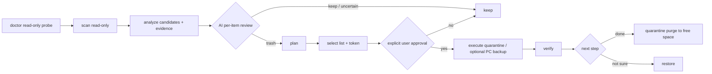

<h1 align="center">Android / HarmonyOS Deep Clean</h1>

<p align="center">
  <b>English</b> | <a href="./README.md">简体中文</a>
  <br><br>
  <a href="https://github.com/ChenChen913/android-deep-clean/actions/workflows/ci.yml"></a>
  <a href="LICENSE"></a>
  
</p>

AI-powered deep-clean skill for Android and HarmonyOS: read-only scan, evidence review, quarantine-based cleanup and restore.

> Status: the read-only pipeline has been verified on a real device over USB + ADB and over the on-device local transport. Quarantine, verify and restore have been exercised on a real device with self-created test files. **No cleanup of real user data has been accepted yet, and HarmonyOS NEXT has 0 real-device validations.** This is not yet a production-grade cleanup tool; see the [real-device acceptance plan](docs/real-device-test-plan.md).

Real terminal excerpt (HONOR HLK-AL00, HarmonyOS 3.0 compat / Android 10, USB + ADB, serial redacted):

```text
$ python "$Skill/scripts/adc.py" devices --adb-path adb
<serial>  device  product:HLK-AL00 model:HLK_AL00

$ python "$Skill/scripts/adc.py" scan --state .adc-state --transport adb --serial <serial> --json --quiet
{"roots_scanned": ["/sdcard"], "stats": {"entries": 125855, "files": 117007, "bytes": 25093192713}, "truncated": false}

$ python "$Skill/scripts/adc.py" analyze --state .adc-state --transport adb --serial <serial> --json --quiet
{"summary": {"candidate_groups": 59, "candidate_files": 74885,
             "candidate_bytes": 5390767059, "review_required": 56}}
```

The cleanup pipeline enforces this order:



## Contents

- [Why this project](#why-this-project)
- [Quick start](#quick-start)
- [Usage](#usage)
- [Configuration](#configuration)
- [Project structure](#project-structure)
- [Development](#development)
- [FAQ](#faq)
- [Known limitations](#known-limitations)
- [Contributing](#contributing)
- [License](#license)

## Why this project

Typical cleaners decide by folder name, file age or size. They can sweep away chat media, game saves inside uninstalled-app residue, or offline installers, and they rarely explain why a file was selected.

This project splits cleanup into auditable steps:

- Scanning is read-only. Every candidate reports paths, file count, size, age, and whether the owning app is still installed.
- The AI must review each candidate and write a reason. Unreviewed CAUTION items cannot enter the selection list.
- The user's selection produces a confirmation token. Execution without a token is refused.
- By default files are moved into an on-device quarantine area and can be restored. Permanent deletion is a separate, explicit second step.
- Before each operation the executor re-checks size, mtime and inode. Changed files are skipped and reported.

The goal is not fast deletion. It is finding long-accumulated files that ordinary cleaners miss without deleting important data.

## Quick start

Requirements:

| Item | Requirement |
|---|---|
| Python | 3.9+ (runtime code uses the standard library only; no pip install needed) |
| PC path (Android / HarmonyOS compat) | Windows 10/11 or macOS/Linux, Android official Platform Tools with `adb` (Android Studio is not required) |
| PC path (HarmonyOS NEXT) | HarmonyOS Command Line Tools or SDK toolchains with `hdc` (the full DevEco Studio IDE is not required) |
| Phone path (optional) | Android phone with Termux, or Shizuku with rish |
| Tests (optional) | pytest |

Install into the Agent Skills directory (Windows):

```powershell
git clone https://github.com/ChenChen913/android-deep-clean.git
cd android-deep-clean
powershell -ExecutionPolicy Bypass -File .\android-deep-clean\scripts\install_skill.ps1
python "$env:USERPROFILE\.agents\skills\android-deep-clean\scripts\adc.py" --version
```

The last command should print `android-deep-clean 1.2.8`. The installer backs up an existing directory, copies the new one, verifies `SKILL.md`, `scripts/adc.py` and `platform.py`, and rolls back on failure.

macOS / Linux installation into a generic skills directory:

```bash
git clone https://github.com/ChenChen913/android-deep-clean.git
mkdir -p ~/.agents/skills
cp -R android-deep-clean ~/.agents/skills/android-deep-clean
python ~/.agents/skills/android-deep-clean/scripts/adc.py --version
```

You can also run it without installing: `python android-deep-clean/scripts/adc.py --help`.

Uninstall (Windows):

```powershell
Remove-Item -Recurse -Force "$env:USERPROFILE\.agents\skills\android-deep-clean"
Remove-Item -Recurse -Force .adc-state
```

Deleting the state directory also deletes the restore journal for quarantined files. Only do it after confirming the quarantine is empty.

## Usage

Choose a path first. All three paths share the same classification, risk levels, protected-path rules, confirmation token, executor and verifier. Only the transport differs.

| Path | Devices | Connection | Key flags |
|---|---|---|---|
| A PC over ADB | Android, HarmonyOS 1.x–4.x compat | USB cable + USB debugging | `--transport adb --serial <serial>` |
| B On-device | Android, HarmonyOS 1.x–4.x compat | Termux local shell or Shizuku rish | `--transport local` or `--transport rish` |
| C PC over HDC | HarmonyOS NEXT (5+) | USB / wireless debugging + `hdc` | `--transport hdc --serial <connect-key> --hdc-path hdc` |

HarmonyOS NEXT cannot use the on-device path: it has no Android runtime, no Termux, no Shizuku and no adb.

### PC: full USB + ADB walkthrough

Common flags must come after the subcommand, for example `doctor --state ...`, not `--state ... doctor`. With more than one connected device you must pass `--serial`.

**Step 1: prepare the phone**

1. Settings → About phone, tap the build number seven times to enable Developer options.
2. Developer options → enable USB debugging.
3. Connect the USB cable. Either "File transfer" or "Charging only" works.
4. Unlock the phone and accept the "Allow USB debugging?" prompt.

**Step 2: prepare the PC**

Install Android official Platform Tools and confirm `adb version` works. Android Studio is not required.

**Step 3: confirm the device**

```powershell
$Skill = "$env:USERPROFILE\.agents\skills\android-deep-clean"
$State = ".adc-state"
$Serial = "<serial>"

python "$Skill\scripts\adc.py" devices --adb-path adb
```

| State | Meaning and action |
|---|---|
| `device` | Authorized, continue |
| `unauthorized` | Not allowed on the phone yet; reconnect and unlock |
| `offline` | Reconnect, or toggle USB debugging off and on |
| `no permissions` | Check the cable, USB mode and driver |

If `adb` is not on PATH, replace the path: `--adb-path "$env:LOCALAPPDATA\Android\platform-tools\adb.exe"`.

**Step 4: read-only probe**

```powershell
python "$Skill\scripts\adc.py" doctor --state $State --transport adb --serial $Serial
```

Read the device model, OS version, total/free storage, privilege tier, and the list of unreadable paths. If the tier is `blocked`, stop and do not pretend to scan.

**Step 5: read-only scan**

```powershell
python "$Skill\scripts\adc.py" scan --state $State --transport adb --serial $Serial
```

The default root is `/sdcard`; with root it also adds `/data/data/*/cache`. Useful flags: `--roots /sdcard/Download`, `--max-depth 32`, `--max-files 500000`, `--no-internal`. The result is a SQLite snapshot; no phone file is modified.

**Step 6: analyze and build evidence**

```powershell
# Hash duplicate candidates on the device (default)
python "$Skill\scripts\adc.py" analyze --state $State --transport adb --serial $Serial

# Or pull only same-size duplicate candidates to the PC and hash locally
python "$Skill\scripts\adc.py" analyze --state $State --transport adb --serial $Serial --hash-mode pc
```

Outputs:

| File | Purpose |
|---|---|
| `report-before.md` | Human-readable pre-clean report |
| `analysis-summary.json` | Compact summary for the AI |
| `analysis.db` | Full candidate and per-file manifest |
| `review-template.json` | Review template |

**Step 7: AI review**

The AI reads `analysis-summary.json` and inspects large, risky or weakly evidenced candidates:

```powershell
python "$Skill\scripts\adc.py" inspect --state $State --transport adb --serial $Serial --id <candidate-id> --list-paths
```

Write the decisions to `review.json`. The format is documented in [SKILL.md](android-deep-clean/SKILL.md) and the [review guide](android-deep-clean/references/review-guide.md). Unreviewed CAUTION items cannot be selected.

**Step 8: build the plan**

```powershell
python "$Skill\scripts\adc.py" plan --state $State --transport adb --serial $Serial --review "$State\analysis\review.json"
```

`plan` only produces a plan. Show the selectable scope, risks and keep suggestions to the user.

**Step 9: user selection and token**

```powershell
# Select by category (example)
python "$Skill\scripts\adc.py" select --state $State --transport adb --serial $Serial --categories app_cache,thumbnails

# Select every selectable SAFE item
python "$Skill\scripts\adc.py" select --state $State --transport adb --serial $Serial --all-safe

# Select exact IDs (safest)
python "$Skill\scripts\adc.py" select --state $State --transport adb --serial $Serial --ids app_cache-xxxxxxxxxx
```

`select` does not execute. It prints the list and the confirmation token. Show paths, count, size and risk to the user and get an explicit yes. If the user declines, stop.

**Step 10: execute (quarantine by default)**

```powershell
python "$Skill\scripts\adc.py" execute --state $State --transport adb --serial $Serial --token <TOKEN>

# Copy selected files to the PC before cleaning; a failed backup keeps the source file
python "$Skill\scripts\adc.py" execute --state $State --transport adb --serial $Serial --token <TOKEN> --backup-to D:\phone-backup
```

Permanent deletion needs a separate confirmation. The selection must be created in delete mode and contain SAFE items only:

```powershell
python "$Skill\scripts\adc.py" select --state $State --transport adb --serial $Serial --all-safe --mode delete
python "$Skill\scripts\adc.py" execute --state $State --transport adb --serial $Serial --token <TOKEN> --mode delete --allow-permanent-delete
```

Files that changed, failed permission checks or are symlinks are skipped and reported. Do not retry them as a forced delete.

**Step 11: verify**

```powershell
python "$Skill\scripts\adc.py" verify --state $State --transport adb --serial $Serial
python "$Skill\scripts\adc.py" export --state $State --out D:\phone-report
```

The report separates logical processed bytes, actually freed bytes, and quarantine occupancy. In quarantine mode actually freed is 0 until `purge`.

**Step 12: restore or purge**

```powershell
# Restore all or specific IDs
python "$Skill\scripts\adc.py" restore --state $State --transport adb --serial $Serial --all
python "$Skill\scripts\adc.py" restore --state $State --transport adb --serial $Serial --ids <candidate-id>

# Permanently free the quarantine (irreversible; confirm again)
python "$Skill\scripts\adc.py" quarantine purge --state $State --transport adb --serial $Serial --token <PURGE_TOKEN>
```

### On-device: Termux (`--transport local`)

Use this when no PC is available. The phone must run Python 3.9+.

```bash
# Termux (install from F-Droid)
pkg install python git
termux-setup-storage

git clone https://github.com/ChenChen913/android-deep-clean.git
cd android-deep-clean

python android-deep-clean/scripts/adc.py doctor  --state .adc-state --transport local
python android-deep-clean/scripts/adc.py scan    --state .adc-state --transport local
python android-deep-clean/scripts/adc.py analyze --state .adc-state --transport local
```

Differences from the PC path:

- No `--serial` or `--adb-path`.
- The state directory and quarantine live on the phone.
- Only shared storage is readable; `/data/data` is not.
- Whether `Android/data` is readable depends on scoped storage. The report lists the paths it could not open.

The remaining steps (inspect, plan, select, execute, verify, restore) are identical; replace `--transport adb --serial ...` with `--transport local`.

### On-device: Shizuku (`--transport rish`)

Shizuku exposes an ADB-shell-equivalent shell through rish:

```bash
python android-deep-clean/scripts/adc.py doctor  --state .adc-state --transport rish --rish-path /path/to/rish
python android-deep-clean/scripts/adc.py scan    --state .adc-state --transport rish --rish-path /path/to/rish
python android-deep-clean/scripts/adc.py analyze --state .adc-state --transport rish --rish-path /path/to/rish
```

Capabilities match an ADB shell; `/data/data` remains unreadable. Start Shizuku on the phone and confirm its service is running before use.

### HarmonyOS NEXT: PC over HDC

HarmonyOS NEXT has no Android runtime, so it requires `hdc` from a PC. Confirm the tool and device first:

```powershell
hdc list targets -v

python "$Skill\scripts\adc.py" doctor  --state $State --transport hdc --serial <connect-key> --hdc-path hdc
python "$Skill\scripts\adc.py" scan    --state $State --transport hdc --serial <connect-key> --hdc-path hdc
python "$Skill\scripts\adc.py" analyze --state $State --transport hdc --serial <connect-key> --hdc-path hdc
```

Boundaries:

- Only the public directory `/storage/media/100/local/files` and the media library `/mnt/data/<uid>/media_fuse/Photo`.
- No APK, adb, Shizuku or Termux; app-private caches cannot be scanned per file.
- `bm clean -c` is reported as a capability only and is never executed automatically.
- Path availability varies by device and user; trust the doctor report. NEXT has not been validated on a real device yet.

HarmonyOS 1.x–4.x compat keeps the Android runtime and uses the ADB path above.

### Four working modes

| Mode | Steps | Modifies the phone |
|---|---|---|
| A Read-only check | doctor → scan → analyze, produce the pre-clean report | No |
| B Deep clean | doctor → scan → analyze → AI review → plan → user select → execute → verify | Yes |
| C Targeted clean | scan/analyze, then narrow `select` by category, app kind or ID | Yes |
| D Re-check | `recheck` rescans and compares with the previous round | No (writes a new snapshot) |

Common targeted selections:

| Goal | Flag |
|---|---|
| WeChat / QQ caches | `--categories chat_cache` |
| Uninstalled-app residue | `--categories residue` (review per package) |
| Old APKs | `--categories apk` |
| Duplicate photos / videos | `--categories duplicates` (confirm per group) |
| Large files unused for a long time | `--categories large_old,media_old` |
| Browser caches | `--app-kinds browser` or `--categories browser_cache` |
| Empty directories | `--categories empty_dirs` (rmdir only) |
| SAFE items only | `--all-safe` |

### Command reference

| Command | Purpose | Modifies the phone |
|---|---|---|
| `devices` | List ADB devices and authorization state | No |
| `doctor` | Probe device, storage, permissions and available commands | No |
| `scan` | Read-only scan, writes a SQLite snapshot | No |
| `analyze` | Build candidates, evidence, risks and the pre-clean report | No |
| `inspect` | Show one candidate's full manifest or preview | No (`--pull` only reads) |
| `plan` | Merge AI review decisions into a plan | No |
| `select` | Build the selection list and confirmation token | No |
| `execute` | Execute with the token; quarantine by default | Yes |
| `verify` | Verify the execution result | No |
| `quarantine purge` | Permanently delete quarantined files and free space | Yes |
| `restore` | Restore files from quarantine | Yes |
| `recheck` | Rescan and compare with the previous round | No (writes a new snapshot) |
| `export` | Export candidate, file and execution CSVs | No |
| `history` | List historical scan snapshots | No |

Exit codes:

| Code | Meaning |
|---|---|
| 0 | Success |
| 2 | Usage error |
| 3 | Refused by safety policy (token, risk, no user approval, not selectable) |
| 4 | Device / transport error |
| 5 | Input or state-file validation failure |
| 6 | Partial failure in execute / verify / purge / restore (reports are still written) |
| 1 | Unexpected error |
| 130 | Interrupted |

### Safety boundaries (mandatory for callers)

- Never bypass this CLI with direct `rm`, `mv`, `find -delete`, `pm clear` or similar commands on the phone.
- Never add DANGEROUS items to a selection. Never lower a risk level.
- Never run `execute`, `quarantine purge` or `restore` without explicit user approval.
- Never delete system directories, app databases or account data, OBB files of installed apps, chat history or chat media, original personal photos/videos, or files of unknown purpose.
- Never follow symlinks. Never empty an entire directory. Only touch explicit paths from the candidate manifest.
- The CLI re-checks size, mtime and inode before each operation; changed files are skipped and reported.
- With multiple devices, always pass `--serial`. Execution verifies that the connected device matches the plan.
- With `--backup-to`, a failed backup or checksum mismatch must keep the source file.
- Never apply Android rules (`/sdcard`, `pm`, `Android/data`) to HarmonyOS NEXT.
- Mark capabilities that have not been verified on a real device as "unverified".

## Configuration

| Item | Required | Default | Description |
|---|---|---|---|
| `ADC_STATE` environment variable | No | `.adc-state` | Default state directory, equivalent to `--state` |
| `--state` | No | `.adc-state` | Directory for doctor/scan/analyze/plan/select/execute artifacts |
| `--transport` | Yes (defaults to adb) | `adb` | `adb`, `hdc`, `rish`, `local`, `mock` |
| `--serial` | Required with multiple devices | empty | ADB serial; connect-key for hdc |
| `--adb-path` | No | `adb` | Path to the `adb` executable |
| `--hdc-path` | No | `hdc` | Path to `hdc` for the hdc transport |
| `--rish-path` | No | `rish` | Path to rish for Shizuku |
| `--config` | No | built-in defaults | JSON overrides for thresholds and safety policy |
| `--json` / `--quiet` | No | off | Machine-readable output / fewer progress messages |

`--config` example:

```json
{
  "thresholds": {
    "apk_old_days": 180,
    "temp_old_days": 30,
    "download_old_days": 30
  },
  "safety": {
    "generic_cache_risk": "caution"
  }
}
```

Key default thresholds (source: `scripts/adc_lib/config.py`):

| Key | Default | Meaning |
|---|---|---|
| `large_file_bytes` | 104857600 | Large-file threshold (100 MiB) |
| `old_file_days` | 365 | Age threshold for large files |
| `apk_old_days` | 180 | Old APK threshold |
| `archive_old_days` | 180 | Old archive threshold |
| `temp_old_days` | 30 | Temporary file threshold |
| `log_old_days` | 90 | Log threshold |
| `screenshot_old_days` | 180 | Old screenshot threshold |
| `media_old_days` | 730 | Old media threshold |
| `download_old_days` | 30 | Old download threshold |
| `safety.generic_cache_risk` | `caution` | Generic cache policy; set to `safe` to restore the old behavior |

## Project structure

```text
.
├── android-deep-clean/          # The skill itself
│   ├── SKILL.md                 # Instructions read by the agent
│   ├── scripts/
│   │   ├── adc.py               # CLI entry, 14 subcommands
│   │   ├── install_skill.ps1    # Backup, copy, verify, roll back on failure
│   │   └── adc_lib/             # Transport, scan, analyze, plan, execute, reports
│   └── references/              # Safety policy, path rules, review guide, USB/ADB, HarmonyOS
├── tests/                       # pytest cases and mock fixtures (no phone needed)
├── docs/                        # Install, CLI contract, HarmonyOS support, acceptance, test report
├── tools/build_dist.ps1         # Packaging script
└── .github/workflows/ci.yml     # ubuntu-22.04 / windows-latest × Python 3.9 / 3.13
```

## Development

Run the full suite (no phone, no network):

```powershell
python -m pytest tests -q
```

Measured on 2026-11-06 / v1.2.8: 195 passed, 1 skipped (196 collected). The skipped case needs symlink creation, which this Windows environment cannot do; Linux CI runs it.

CI matrix: `ubuntu-22.04`, `windows-latest` × Python `3.9`, `3.13` — 4 jobs. See [.github/workflows/ci.yml](.github/workflows/ci.yml).

Without a phone, use the mock transport to exercise the whole pipeline:

```powershell
python android-deep-clean\scripts\adc.py scan --state .tmp\state --transport mock --mock-root .tmp\phone --mock-packages .tmp\packages.json --mock-caps .tmp\caps.json
```

Fixture formats are documented in the [CLI contract](docs/cli-contract.md).

## FAQ

**Q: `adb devices` shows `unauthorized`.**
A: Unlock the phone and accept the RSA prompt. If no prompt appears, reconnect the cable, or toggle USB debugging off and on.

**Q: `Android/data` is unreadable. Is the skill broken?**
A: No. Android 11+ scoped storage limits a plain ADB shell. The doctor report marks the tier as `limited` and lists unreadable paths. It never pretends the scan was complete.

**Q: Execution succeeded but free space did not change.**
A: The default mode quarantines files by moving them, so they still occupy space. Run `quarantine purge` after confirming the result to actually free space.

**Q: Why can't I select CAUTION items directly?**
A: CAUTION items require an AI review written into `review.json`, followed by `plan`. Unreviewed CAUTION items never enter a selection. This is intentional.

**Q: Can HarmonyOS NEXT use adb?**
A: No. NEXT has no Android runtime and requires `--transport hdc`. Only HarmonyOS 1.x–4.x compat keeps the adb path.

**Q: Can I delete `.adc-state`?**
A: Yes, but you lose the restore journal for the quarantine, so `restore` can no longer recover those files.

**Q: Two phones are connected at the same time.**
A: Every device command must pass `--serial`. Plans, selections and executions are bound to a device identity; running them on another device is refused.

## Known limitations

- Without root, `/data/data` is unreadable; on some ROMs `Android/data` is unreadable too.
- Generic app caches and browser caches default to CAUTION and need per-item review. Only thumbnails and clear temporary logs default to SAFE.
- Quarantine does not free space. Reports separate quarantined, unprocessed, actually freed and quarantine occupancy.
- Similar-but-not-identical images are not compared visually; only exact duplicates are detected, and the user still confirms each group.
- atime is unreliable on Android, so age is based on mtime. Anomalous mtimes (before 2000, or more than 24 hours in the future) do not drive candidate selection.
- No system-level cleanup (system cache partitions, OTA). `pm`/`find` behavior differs across ROMs.
- Quarantine and restore depend on the local state directory; losing it prevents automatic restore.
- HarmonyOS NEXT handles public directories and the media library only; app-private caches cannot be scanned per file, and `bm clean` is not wired into the executor.
- The on-device Termux / Shizuku paths have not been accepted on a real device.

Real-device status:

| Item | Status |
|---|---|
| Read-only on a real device (local + ADB) | 1 device passed: HONOR HLK-AL00, HarmonyOS 3.0 compat / Android 10 |
| Quarantine / verify / restore | 1 device passed, self-created test files only |
| Cleanup of real user data | 0 devices accepted |
| Permanent delete (purge) | Not verified on a real device |
| Shizuku / native Termux | Not verified on a real device |
| HarmonyOS NEXT (hdc) | 0 devices accepted |

See the [test report](docs/test-report.md) and the [real-device acceptance plan](docs/real-device-test-plan.md).

## Contributing

Issues and pull requests are welcome. When changing cleanup rules or safety logic, add regression tests and keep `python -m pytest tests -q` green. Do not weaken safety assertions to make tests pass.

Report problems via [Issues](https://github.com/ChenChen913/android-deep-clean/issues). Before contributing, read the [safety policy](android-deep-clean/references/safety-policy.md) and the [CLI contract](docs/cli-contract.md).

Maintainer: repository owner [@ChenChen913](https://github.com/ChenChen913).

## License

[MIT](LICENSE) © 2026 Android Deep Clean contributors
